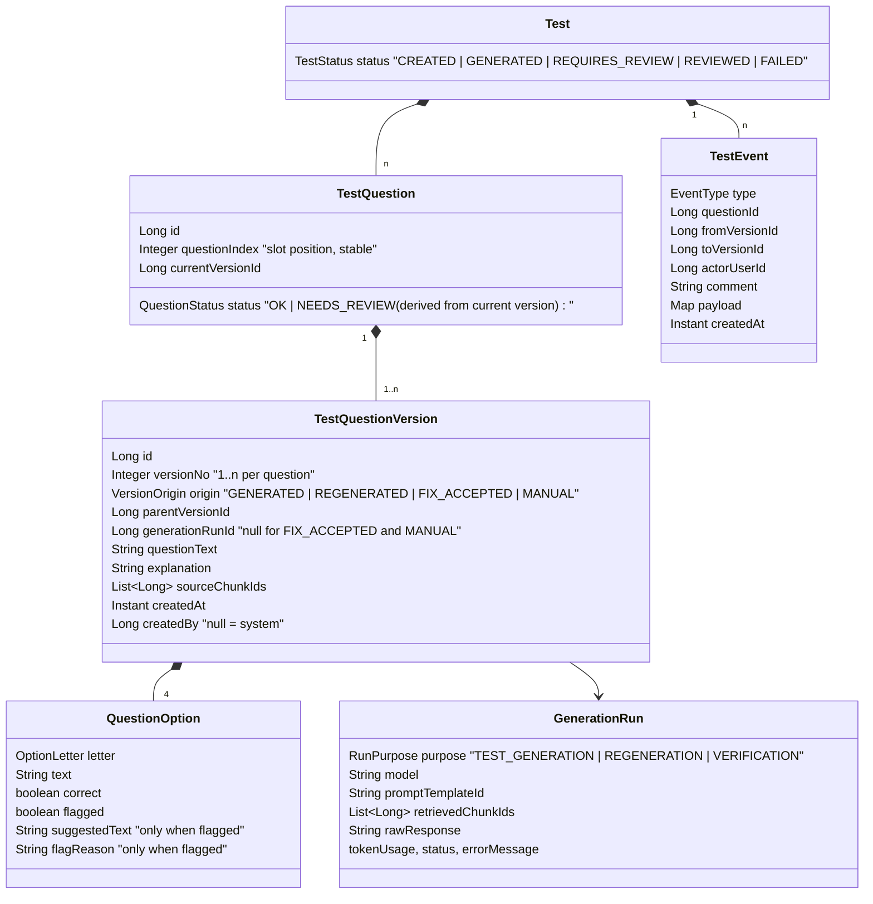
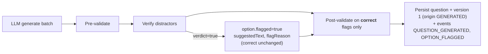
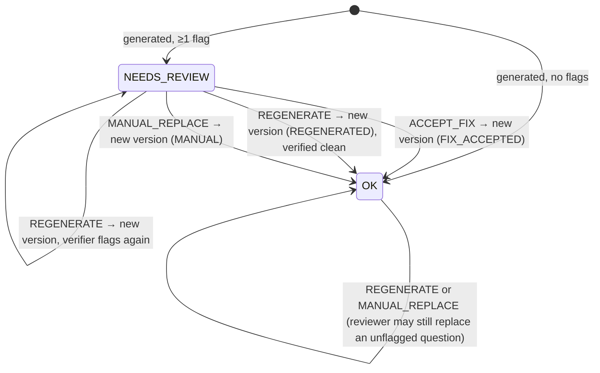

# ADR001 - Test Review Process and Question History
* Date: Nov 12, 2026
* Status: [ACCEPTED] (implemented Nov 12, 2026)
* Author: Irina Mijatovic (drafted with Claude Code)

## Decision

Replace the three-tier option model (original / verified / final text and verdict, plus the `OK/FLAGGED/RESOLVED`
option state and `ReviewDecisionType`) with **immutable question versions** and an **append-only event log**.

- Test generation may leave questions in `NEEDS_REVIEW`, with specific options **flagged** by the verifier. Each
  flag carries a suggested replacement text and a reason.
- A flag never changes which options are correct. Correctness is always the `correct` flag of the current
  version's options.
- A reviewer resolves a question with exactly one of three actions:
  1. **Accept fix**: create a new version in which every flagged option's text is replaced by its suggestion.
  2. **Regenerate**: create a new version with a freshly generated question from the same test context. The new
     version is verified again and may itself need review.
  3. **Manual replace**: create a new version from a question the reviewer writes, with question text, four
     options and their correct flags, plus an optional explanation. The reviewer is the author, so the version is
     not LLM-verified and has no flags.
- Every version is kept forever. Every state change (generation, flag, fix, regeneration, test status change) is
  written as an event with actor and timestamp. Together they form the history trail of the test and its
  questions.

## Context

### Requirements

1. Each test and question needs a history trail: what was generated first, what was regenerated, and what was
   changed during review and by whom.
2. The review process must be simple: generation can leave questions flagged, and review either switches to a
   new (regenerated) question, accepts the suggested fix, or replaces the question manually with the reviewer's
   own question and options.

### Current state (as of the uncommitted work in progress)

The generation flow is described in [06 – Test Generation](../architecture/06-test-generation.md). The review
side is only partly built:

| Aspect | Current implementation | Problem |
|---|---|---|
| Option model | `originalText`, `replacementText`, `finalText`, `originalVerdict`, `verifiedVerdict`, `finalVerdict`, `state`. The effective verdict is `final ?? verified ?? original` | Six mutable fields per option, priority rules spread over the domain, mapper and DTO. Hard to explain, test and display |
| Effect of a flag | Sets `verifiedVerdict=true`, so the flagged distractor immediately **counts as correct** | `SINGLE_CORRECT` questions then have 2 correct options and are **silently dropped** by post-validation. `MULTIPLE_CORRECT` questions change their answer key before any human has looked at them |
| Review decisions | `ReviewDecisionType` has 3 options (reject verification, replace as distractor, flip verdict) | No service or endpoint implements them. Flipping the verdict can break cardinality rules |
| History | Columns are overwritten in place. `generation_runs` exists but is never written. Audit columns are hard-coded to user `1` | No record of what the LLM generated or who changed what. Impossible to reconstruct a question as an attempt saw it |
| Regeneration | Does not exist | A bad question can only be kept or deleted |
| Attempts | `attempt_answers.question_id` | If a question changes after an attempt, the attempt points at content the user never saw |

### Observation that enables the simplification

The verifier only ever asks one thing: *"is this distractor actually true?"* For every flag, it also proposes a
**clearly false** replacement. Accepting that replacement gives a valid question **whether or not the verifier
was right**:

- If the verifier was right, a wrong distractor is replaced. ✔
- If the verifier was wrong, a good distractor is replaced by another good distractor. ✔ (slight loss of quality,
  no loss of correctness)

So the LLM-assisted "keep as is" and "flip verdict" decisions are not needed for correctness. "Accept fix" and
"Regenerate" cover every flag. "Manual replace" covers the remaining cases, where the reviewer knows better than
both LLMs, without option-level override fields.

## Options Considered

### Option 1 (SELECTED): Immutable question versions + event log, three review actions

#### Domain model



The rules fit in a few lines:

- A version is **immutable** once written. Changing a question means writing a new version and moving
  `currentVersionId`.
- `QuestionOption` replaces the three-tier fields with: `text`, `correct`, `flagged`, `suggestedText` and
  `flagReason`.
- `TestQuestion.status = NEEDS_REVIEW` if any option of the current version is flagged, otherwise `OK`.
- `Test.status = REQUIRES_REVIEW` while any question is `NEEDS_REVIEW`. The transition to `REVIEWED` happens
  automatically when the last flagged question is resolved, which only occurs through review (unflagged tests go
  straight to `GENERATED`).
- `OptionState`, `ReviewDecisionType`, `replacementText`, `finalText`, `originalVerdict`, `verifiedVerdict`,
  `finalVerdict`, `getEffectiveText/Verdict` and `isRequiresReview` are **removed**.

#### Generation flow change



- Verification only sets flags. Post-validation uses `correct`, so flagged questions are **kept** for review
  instead of being dropped (this fixes the `SINGLE_CORRECT` drop).
- Use the `incorrect-options-verification-only-flagged` prompt variant: the verifier returns only true verdicts,
  which keeps the response small.
- Each LLM call is written to `generation_runs` (raw response, model, prompt template, chunks, token usage). Each
  version links to the run that produced it, which answers *"what exactly did the LLM return"*.

#### Review actions



| Action | Precondition | Effect |
|---|---|---|
| `ACCEPT_FIX` | Current version has ≥1 flagged option, and every flagged option has a `suggestedText` | New version copies the current one. For each flagged option, `text := suggestedText` and the flag is cleared. `correct` is unchanged. Not re-verified (the suggestion is the verifier's own "clearly false" text) |
| `REGENERATE` | Test is `GENERATED`, `REQUIRES_REVIEW` or `REVIEWED` | One question generated from the test's `test_used_chunks`, with the same cardinality constraint as the slot. The prompt lists the test's other current question texts to avoid duplicates. The same pre-validation, verification and post-validation pipeline runs. On failure, no new version is written and a `REGENERATION_FAILED` event is recorded |
| `MANUAL_REPLACE` | Test is `GENERATED`, `REQUIRES_REVIEW` or `REVIEWED` | Request carries `questionText`, options A–D (`text`, `correct`) and an optional `explanation`. Only the **non-LLM** rules of `TestQuestionValidator` run: normalization, structure, bundled options, count-revealing wording, correct-options cardinality for the test's `answerCardinality`, and no duplicate of another current question in the test. A rule failure returns 400 with the reasons and writes nothing. On success a new version is written with `origin = MANUAL`, no flags and `sourceChunkIds` copied from the previous version. Options are **not shuffled**, because the reviewer chose the order |

All actions:

- take `expectedCurrentVersionId` in the request (optimistic concurrency). A mismatch returns 409, so two
  reviewers can't overwrite each other.
- record `actorUserId` from `ExecutionContext.userId()`, plus an optional comment.
- recompute the question status and the test status in the same transaction. The LLM call for `REGENERATE`
  runs **outside** the transaction, following the existing helper-bean pattern.

#### History trail

Each step below appends one row to `test_events`:

| Event type | Written when | Actor |
|---|---|---|
| `TEST_CREATED`, `TEST_GENERATED`, `TEST_REQUIRES_REVIEW`, `TEST_REVIEWED`, `TEST_FAILED` | Test status changes | system or user |
| `QUESTION_GENERATED` | Version 1 of a question persisted | system |
| `OPTION_FLAGGED` | Verifier flagged an option (payload: letter, reason, suggestion) | system |
| `FIX_ACCEPTED` | Review action, `from → to` version | user |
| `QUESTION_REGENERATED` / `REGENERATION_FAILED` | Review action | user |
| `QUESTION_MANUALLY_REPLACED` | Review action, `from → to` version | user |

Questions answered by the trail:

- *What was generated initially?* Version 1 of each question, plus its `generation_run.raw_response`.
- *What was regenerated?* Versions with `origin = REGENERATED` and their `QUESTION_REGENERATED` events.
- *What changed in review, and by whom?* `FIX_ACCEPTED`, `QUESTION_REGENERATED` and
  `QUESTION_MANUALLY_REPLACED` events with `actorUserId`, plus a diff between `fromVersionId` and `toVersionId`.
  For manual replacements, the version's `createdBy` also identifies the author.

#### Schema (replaces the uncommitted `test_question_options` design)

```sql
test_questions (id, tenant_id, test_id, question_index, current_version_id, status, audit…,
                UNIQUE (test_id, question_index))

test_question_versions (id, tenant_id, question_id FK, version_no, origin, parent_version_id FK NULL,
                        generation_run_id FK NULL, question_text, explanation, source_chunk_ids_json JSONB,
                        created_at, created_by NULL,
                        UNIQUE (question_id, version_no))

test_question_version_options (version_id FK, option_letter, text, correct, flagged,
                               suggested_text NULL, flag_reason NULL,
                               PRIMARY KEY (version_id, option_letter))

test_events (id, tenant_id, test_id FK, question_id NULL, event_type, from_version_id NULL,
             to_version_id NULL, actor_user_id NULL, comment NULL, payload_json JSONB, created_at)

generation_runs  -- existing table, add: tenant_id, purpose, batch_index, token usage; start writing it

attempt_answers  -- add question_version_id, so an attempt keeps pointing at the content the user saw
```

Versions and events are **insert-only**. Nothing updates or deletes them except a cascade when the whole test is
deleted.

#### API

| Method | Path | Purpose |
|---|---|---|
| GET | `/api/tests/{id}/questions` | Current version of each question, with flags and `status` |
| GET | `/api/tests/{id}/questions/{qid}/versions` | All versions of a question (for diffing) |
| GET | `/api/tests/{id}/events` | Test history trail (filter by `questionId`) |
| POST | `/api/tests/{id}/questions/{qid}/accept-fix` | Body: `{expectedCurrentVersionId, comment?}` |
| POST | `/api/tests/{id}/questions/{qid}/regenerate` | Body: `{expectedCurrentVersionId, comment?}` |
| POST | `/api/tests/{id}/questions/{qid}/manual-replace` | Body: `{expectedCurrentVersionId, questionText, options: {A:{text, correct}, …, D:{…}}, explanation?, comment?}` |

#### Consequences
* Adopted because: the review process has 3 whole-question actions instead of 3 option-level decisions × 6
  fields. The API, UI and tests
  all get simpler.
* Adopted because: a full, tamper-evident history (insert-only versions and events) with actor and timestamp
  meets the audit requirement directly.
* Adopted because: flags no longer change correctness. Flagged questions are reviewed instead of silently
  dropped, and the answer key never changes without a human action.
* Adopted because: attempts can reference an exact version, so scores stay explainable after edits.
* Adopted because: regeneration reuses the existing generation and validation pipeline with a question count
  of 1.
* Adopted despite: more rows (one version per change, 4 options per version) and an extra join to read the
  current question. This is acceptable at the expected volumes; `current_version_id` makes the join direct.
* Adopted despite: no one-click "keep original, verifier was wrong" action. A false-positive flag costs a
  slightly weaker distractor if the fix is accepted. Alternatively the reviewer can use manual replace and
  re-enter the original text. A `DISMISS_FLAG` action can be added later as another event type without changing
  the model.
* Adopted despite: manually written questions are not LLM-verified and may not be grounded in the source chunks.
  This is acceptable because the reviewer is the human authority, and the author is recorded.
* Adopted despite: it replaces the three-tier option work in progress (uncommitted), so that work is discarded.

### Option 2: Keep the three-tier option model and add an audit table

Implement the `ReviewDecisionType` decisions on the current mutable columns, and log each change to an audit
table (for example Hibernate Envers or a custom `option_audit`).

#### Consequences
* Rejected because: the effective-value priority rules and the six fields per option remain. This is the
  complexity the requirement asks to remove.
* Rejected because: the flag still changes correctness, so the `SINGLE_CORRECT` drop and the silent change of
  answer keys remain.
* Rejected because: regeneration doesn't fit, because a whole new question cannot be expressed as option-level
  overrides.
* Rejected despite: a smaller schema change.

### Option 3: Event sourcing (state rebuilt only from events)

Store only events and derive the question state by replaying them.

#### Consequences
* Rejected because: replay infrastructure, snapshots and projections are disproportionate for one aggregate.
* Rejected because: every read path (test display, attempts, scoring) would need projections.
* Rejected despite: it would give the most complete history. Option 1 already provides the needed history with
  immutable versions plus an event log.

### Option 4: Regenerate spare questions during generation

Generate extra "spare" questions during generation, and have review swap a flagged question for a spare.

#### Consequences
* Rejected because: it pays the LLM cost up front for spares that are mostly unused, and the spares can be
  flagged too.
* Rejected despite: switching would be instant during review. On-demand regeneration takes one LLM call, which
  is acceptable for a reviewer action.

## Implementation outline

1. Schema: new tables and columns in the main DB migration. `V1` is still edited in place while no persistent
   environment exists. Otherwise use `V2__question_versions_and_events.sql`.
2. Core model: `TestQuestion`, `TestQuestionVersion`, `QuestionOption`, `TestEvent`, the enums `QuestionStatus`,
   `VersionOrigin` and `TestEventType`. Remove `OptionState`, `ReviewDecisionType` and the three-tier fields.
3. Generation: the verifier sets flags only. Post-validation uses `correct`. Persist version 1 and events. Write
   `generation_runs`.
4. A new `TestReviewService` (core) with `acceptFix`, `regenerate` and `manualReplace`, plus a transactional helper bean, following
   the existing pattern.
5. JPA entities, mappers and repository adapters. API endpoints and DTOs (`TestQuestionDto` exposes the current
   version, `TestQuestionVersionDto`, `TestEventDto`).
6. Unit tests for status derivation and all three review actions. Integration test for the schema.
7. Update [03](../architecture/03-domain-model.md), [06](../architecture/06-test-generation.md), [08](../architecture/08-rest-api.md) and `DOMAIN_MODEL.md`.

## Implementation notes

Implemented as proposed, with these additions:

* `test_question_versions.verification_run_id` links each version to the verification call that checked it.
  `OPTION_FLAGGED` events carry the same id.
* `GET /api/tests/{id}/generation-runs` exposes the recorded LLM calls (raw responses and tokens).
* Regeneration rejects a candidate that duplicates any current question of the test (`REGENERATION_FAILED`, 502),
  and preserves the slot's kind: a multi-correct question is regenerated as multi-correct.
* `QuestionBatchGenerator` (prompt → LLM → pre-validate → verify → post-validate) is shared by generation and
  regeneration. `GenerationRunRecorder` and `TestHistoryRecorder` write runs and events.
* The default verification prompt is now `incorrect-options-verification-only-flagged`. (Superseded by
  [ADR003](ADR003-grounded-reason-first-verification.md): the default is `incorrect-options-verification`, with
  sources, the answer key and an explanation before each verdict.)
* Pre-validation still discards malformed LLM questions before verification. Manual replace uses the non-LLM rules
  and returns every failing reason.

## Open questions

* Should `REGENERATE` and `MANUAL_REPLACE` be allowed on `OK` (unflagged) questions? The proposal says yes,
  because reviewers may dislike a question for other reasons.
* Should a manually written question optionally be sent through LLM verification as a second opinion
  (flagging it, without blocking)? The proposal says no for now.
* Should `REVIEWED` tests become read-only once attempts exist? The proposal says no: versioned attempt answers
  keep old attempts consistent anyway. (Resolved by [ADR005](ADR005-publish-tests.md): a test becomes read-only
  when it is explicitly published, and only published tests accept attempts.)
* Should regeneration use the test's original `test_used_chunks` or retrieve fresh chunks? The proposal uses the
  original chunks, for reproducibility.

## Advice
* [Advice offered] - [Name, Role, Date]

## Supporting Material
* [Architecture – Test Generation](../architecture/06-test-generation.md)
* [Architecture – Domain Model](../architecture/03-domain-model.md)
* [Architecture – Known Issues](../architecture/11-known-issues-and-roadmap.md)
