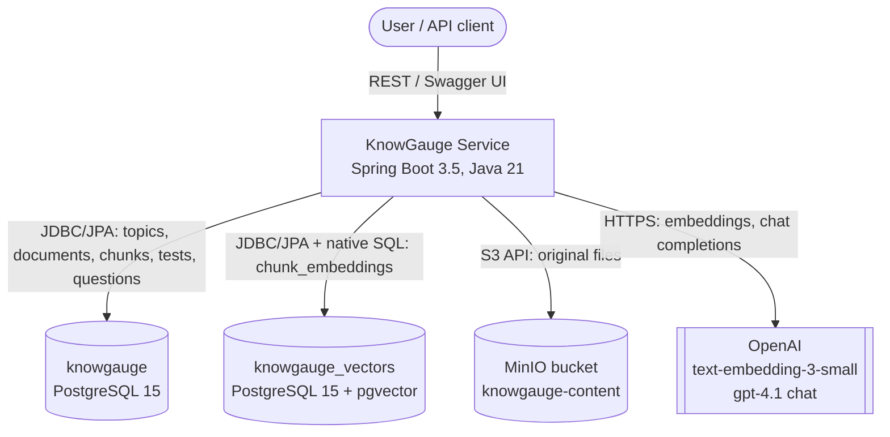
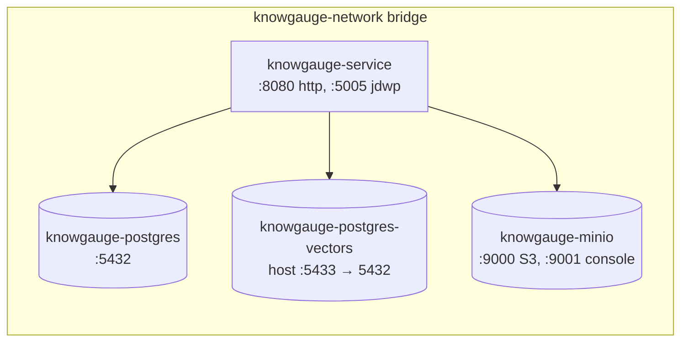

# 01 – System Overview

## Purpose

KnowGauge turns a private knowledge base (uploaded documents, organized by topic) into **grounded multiple-choice
assessments**. Grounding means the questions, correct answers and explanations must come from the uploaded
content, not from the LLM's general knowledge. The service:

- stores documents and organizes them in an unlimited-depth **topic tree**
- **ingests** documents: extracts text, chunks it and creates vector embeddings
- **generates tests** from a chosen scope (topics and/or documents) using retrieved chunks as the LLM context
- **verifies** incorrect options with a second LLM pass and flags suspicious ones for human review
- records generation metadata (model, prompt template, used chunks, timestamps, errors) so runs can be reproduced

Planned but not implemented yet: test attempts and scoring, users and tenants, authentication (see
[11](11-known-issues-and-roadmap.md)).

## System context

| External system | Role | Adapter module |
|---|---|---|
| PostgreSQL (`knowgauge`) | System of record for the relational domain | `knowgauge-service-infra-repository-springdata-jpa` |
| PostgreSQL + pgvector (`knowgauge_vectors`) | Chunk embeddings and chunk sampling | `knowgauge-service-infra-vectorstore-pgvector` |
| MinIO | Original document binaries | `knowgauge-service-infra-storage-minio` |
| OpenAI embeddings | Chunk embeddings (1536-dim) | `knowgauge-service-infra-embedding-langchain4j-openai` |
| OpenAI chat | MCQ generation and incorrect-option verification | `knowgauge-service-infra-testgeneration-langchain4j-openai` |

## Runtime topology (Docker Compose)

The app is a **single deployable** (`knowgauge-service-rest-api` fat jar). The app container waits for the three
backing services to report healthy before it starts. See [09](09-configuration-and-deployment.md).

## Technology stack

| Concern | Technology |
|---|---|
| Language / runtime | Java 21 (Temurin) |
| Framework | Spring Boot 3.5.16 (Web MVC, Data JPA, Actuator, Validation) |
| Build | Maven multi-module reactor (no wrapper committed) |
| LLM / embeddings | LangChain4j 1.1.0 (`OpenAiChatModel`, `OpenAiEmbeddingModel`, recursive splitter) |
| PDF parsing | Apache PDFBox 3 (`Loader`, `PDFTextStripper`) |
| Relational persistence | Hibernate 6.6 / Spring Data JPA, PostgreSQL 15, Hypersistence Utils (`hypersistence-utils-hibernate-63`) `JsonType` for JSONB |
| Vector store | pgvector (`vector(1536)`, IVFFlat cosine index), Hibernate `SqlTypes.VECTOR` |
| Schema migrations | Flyway 11 (with `flyway-database-postgresql`), two independent Flyway instances (one per database) |
| Object storage | MinIO Java SDK (OkHttp client with explicit timeouts) |
| Resilience | Resilience4j 2.2 (Retry, CircuitBreaker, Bulkhead annotations) |
| Mapping | MapStruct 1.5.5 (entity↔domain, domain↔DTO) |
| Boilerplate | Lombok 1.18.46 (`@SuperBuilder`, `@Getter/@Setter`, `@Slf4j`) |
| API docs | springdoc-openapi 2.8 (Swagger UI at `/swagger-ui.html`) |
| Packaging | Multi-stage Dockerfile (maven:3.9-temurin-21 → temurin:21-jre-alpine) |

## Quality attributes & design drivers

| Driver | How the design addresses it |
|---|---|
| **Grounding / answer correctness** | Closed-world prompts, source chunk citations, a rule-based validator, an LLM verifier for incorrect options and a three-tier verdict model with human review (`REQUIRES_REVIEW`) |
| **Reproducibility** | Test stores model, prompt template id, generation params (JSONB), used chunks (`test_used_chunks`), lifecycle timestamps and error message. Chunks carry SHA-256 checksums |
| **Swappable providers** | Hexagonal architecture: core declares ports, and each provider lives in its own infra module |
| **Cost and token limits** | Batch generation with automatic batch-size reduction on `finish_reason=length` and a zero-progress guard |
| **Bounded DB load on big corpora** | Per-document quotas and window-function sampling (`row_number() … ≤ maxChunks`) instead of loading all embeddings |
| **Multi-tenancy readiness** | `tenant_id` on most tables and an `ExecutionContext` port (currently hard-wired to tenant 1) |
