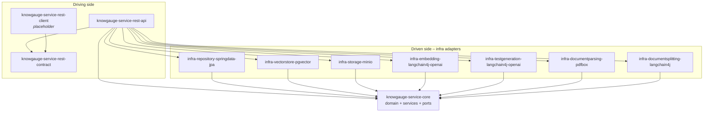
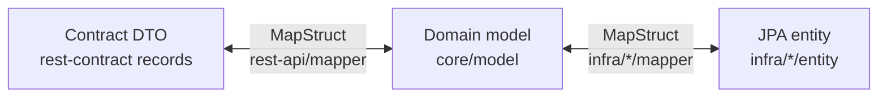

# 02 – Modules & Layering

## Architectural style

KnowGauge follows a **hexagonal (ports & adapters)** architecture, split into Maven modules:

- **`core`** holds the domain model, application services and the **port interfaces** (repository, vector store,
  storage, embedding, LLM, parser, splitter). It has no JPA, MinIO or OpenAI dependencies. It does depend on
  Spring (`@Service`, `@Transactional`, `@ConfigurationProperties`) and on Spring Data's `Page`/`Pageable` types.
- **`infra/*`** contains one module per external technology. Each implements one or more core ports.
- **`rest-api`** is the driving adapter and the composition root: controllers, DTO mapping, exception handling,
  Spring Boot `main`, configuration and Flyway scripts.
- **`rest-contract`** holds the public DTOs, which external clients can share.
- **`rest-client`** is a placeholder for a Java client SDK (empty).



The dependency rule is that **infra modules depend on core, and core never depends on infra**. Only `rest-api`
puts everything on one classpath. `@SpringBootApplication(scanBasePackages = "com.knowgauge")` picks up every
`@Service`, `@Component` and `@Repository` adapter.

## Module catalogue

| Module | Base package | Responsibility |
|---|---|---|
| `knowgauge-service-core` | `com.knowgauge.core` | Domain model, services, ports, prompt templates (`src/main/resources/prompttemplates`) |
| `knowgauge-service-rest-contract` | `com.knowgauge.contract` | Request/response records (`TestInput`, `TestDto`, `TopicDto`, …) with OpenAPI `@Schema` |
| `knowgauge-service-rest-client` | `com.knowgauge.client` | Placeholder only |
| `knowgauge-service-rest-api` | `com.knowgauge` / `com.knowgauge.restapi` | Boot app, controllers, MapStruct DTO mappers, exception handler, execution context, dev seeder, `application*.properties`, Flyway SQL, static landing page |
| `infra-repository-springdata-jpa` | `com.knowgauge.infra.repository.jpa` | Main datasource, EMF, `transactionManager`, Flyway, JPA entities, MapStruct entity mappers, Spring Data repos and port adapters |
| `infra-vectorstore-pgvector` | `com.knowgauge.infra.vectorstore.pgvector.jpa` | Vector datasource, `vectorEntityManagerFactory`, `vectorTransactionManager`, `pgvectorFlyway`, `ChunkEmbeddingEntity`, `PgVectorStore` |
| `infra-storage-minio` | `com.knowgauge.infra.storage.minio` | `MinioClient` config, `MinIoStorageService` |
| `infra-embedding-langchain4j-openai` | `com.knowgauge.infra.embedding.langchain4j.openai` | `OpenAiEmbeddingModel` bean, `OpenAiEmbeddingServiceImpl` |
| `infra-testgeneration-langchain4j-openai` | `com.knowgauge.infra.testgeneration.langchain4j.openai` | Two `OpenAiClient` beans, generation and verification adapters, LLM-response DTOs and mappers |
| `infra-documentparsing-pdfbox` | `com.knowgauge.infra.documentparsing.pdfbox` | `PdfPageExtractionService` (one string per page) |
| `infra-documentsplitting-langchain4j` | `com.knowgauge.infra.documentsplitting.langchain4j` | `LangChainDocumentSplitter` (recursive splitter) |

## Ports and their adapters

| Port (core) | Package | Adapter (infra) | Notes |
|---|---|---|---|
| `TopicRepository`, `DocumentRepository`, `DocumentChunkRepository`, `DocumentSectionRepository`, `TestRepository`, `TestQuestionRepository`, `AttemptRepository`, `AttemptAnswerRepository`, `GenerationRunRepository` | `core.port.repository` | `*JpaRepositoryAdapter` | Each adapter wraps a Spring Data `*JpaRepository` and maps entity↔domain with MapStruct |
| `VectorStore` | `core.port.vectorstore` | `PgVectorStore` | Spring Data for CRUD, native SQL through `@PersistenceContext(unitName="pgvector")` for sampling |
| `StorageService` | `core.port.storage` | `MinIoStorageService` | Returns `StoredObject` record (key, etag, versionId, size, contentType) |
| `EmbeddingService` | `core.port.embedding` | `OpenAiEmbeddingServiceImpl` | Exposes `modelName()`. Embeddings are only comparable within the same model |
| `DocumentParser` | `core.port.documentparser` | `PdfPageExtractionService` | Chosen at runtime by `contentType()` from a `List<DocumentParser>` |
| `DocumentSplitter` | `core.port.documentsplitter` | `LangChainDocumentSplitter` | Takes the core `ChunkingPolicy` |
| `LlmTestGenerationService` | `core.port.testgeneration` | `LlmTestGenerationServiceImpl` | prompt → `List<TestQuestion>` |
| `LlmIncorrectOptionsVerificationService` | `core.port.testgeneration` | `LlmIncorrectOptionsVerificationServiceImpl` | Mutates options in place and returns the flagged count |
| `CurrentTenantProvider`, `CurrentUserProvider`, `ExecutionContext` | `core.context` | `DefaultTenantProvider`, `DefaultUserProvider`, `DefaultExecutionContext` (rest-api) | Return the fixed `kg.context.tenant-id` / `user-id` (1/1 in `local` and `test`, `KG_TENANT_ID` / `KG_USER_ID` in `prod`) until authentication exists |

## Core package structure

```
com.knowgauge.core
├── context/            ExecutionContext, CurrentTenantProvider, CurrentUserProvider (ports)
├── exception/          BaseException hierarchy: Storage*, Embedding*, Duplicate*, LlmResponseParsingException
├── model/              Domain POJOs (Lombok @SuperBuilder), PersistedObject → AuditableObject
│   └── enums/          Status / mode / cardinality enums
├── port/               Outbound ports (see table above)
├── service/
│   ├── content/        TopicService, DocumentService
│   ├── ingestion/      IngestionService (+ two transactional helper beans)
│   ├── chunking/       ChunkingService, ChunkingPolicy, ChunkingProperties
│   ├── retrieving/     RetrievingService (quota-based chunk sampling)
│   └── testgeneration/ TestGenerationService (+ transactional helper, defaults properties)
│       ├── prompt/     Template loader/renderer, TestGenerationPromptBuilder, VerificationPromptBuilder
│       ├── schema/     SchemaProvider beans (JSON output templates)
│       └── validation/ TestDraftValidator, TestQuestionValidator, Pre/PostLlm validators
├── storage/            StorageKeyBuilder, StorageProperties
└── util/               HashingHelper (SHA-256)
```

## Mapping layers

Three representations of each concept are kept separate:



- **API mappers** (`com.knowgauge.restapi.mapper`) convert string enums from the input DTOs through
  `EnumParser`/`EnumMappingHelper`. `TestQuestionMapper` flattens the option map into `TestQuestionOptionDto`s
  and exposes `correctOptions` derived from the effective verdicts.
- **Entity mappers** (`…infra.repository.jpa.mapper`, `…pgvector.jpa.mapper`) are MapStruct interfaces.
  `TestEntityMapper` turns the `topics` and `documents` entity collections into ID lists, and rebuilds them on the
  way back with `getReferenceById` proxies. `usedChunks` is not written through the mapper; it is set by
  `TestRepository.setUsedChunks`.
  `TestQuestionEntityMapper` turns the `EnumMap<OptionLetter, TestQuestionOption>` into a list of
  `TestQuestionOptionEntity` and back.

## Transactional helper beans

Spring `@Transactional` works through proxies, so self-invocation is not transactional. For that reason the
orchestrating services are deliberately **not** transactional. They call separate beans whose methods each run
as a short transaction:

| Orchestrator (no tx) | Helper bean | Transaction manager |
|---|---|---|
| `IngestionServiceImpl` | `IngestionTransactionalServiceImpl` | `transactionManager` (main DB) |
| `IngestionServiceImpl` | `IngestionVectorTransactionalServiceImpl` | `vectorTransactionManager` (vector DB) |
| `TestGenerationServiceImpl` | `TestGenerationTransactionalServiceImpl` | `transactionManager` |

This keeps long-running external calls (OpenAI, MinIO) **outside** DB transactions. Status updates such as
`INGESTING`/`FAILED` and `CREATED`/`FAILED` commit independently, so they are visible even if a later step fails.
