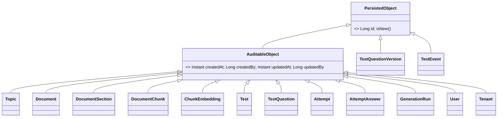
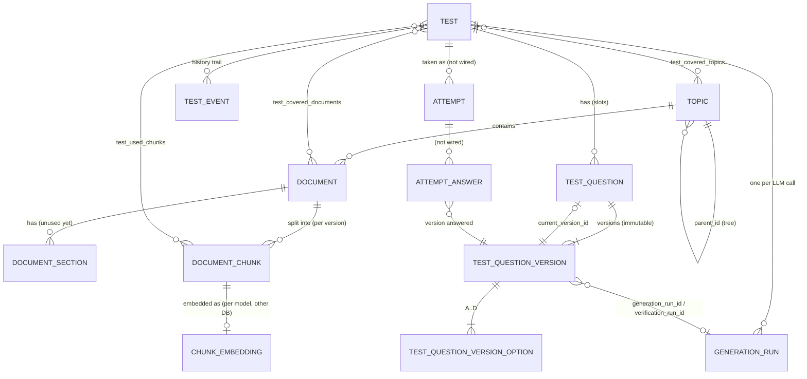
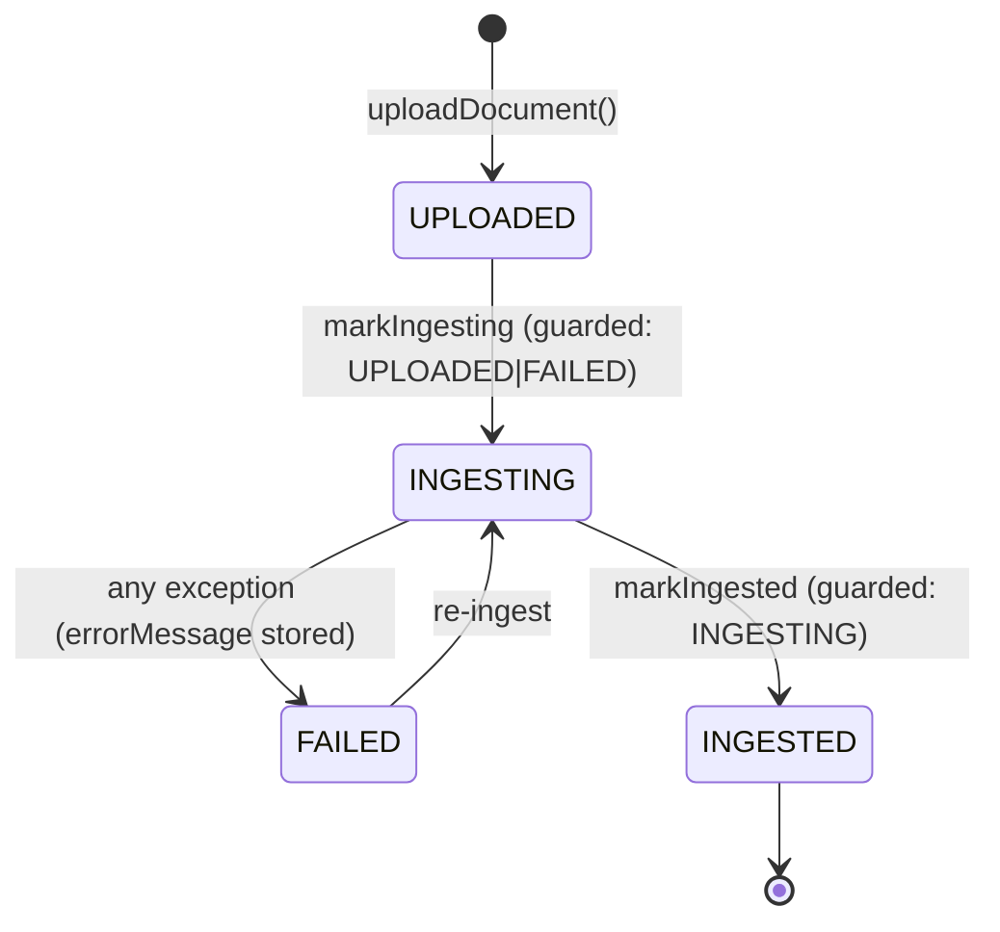
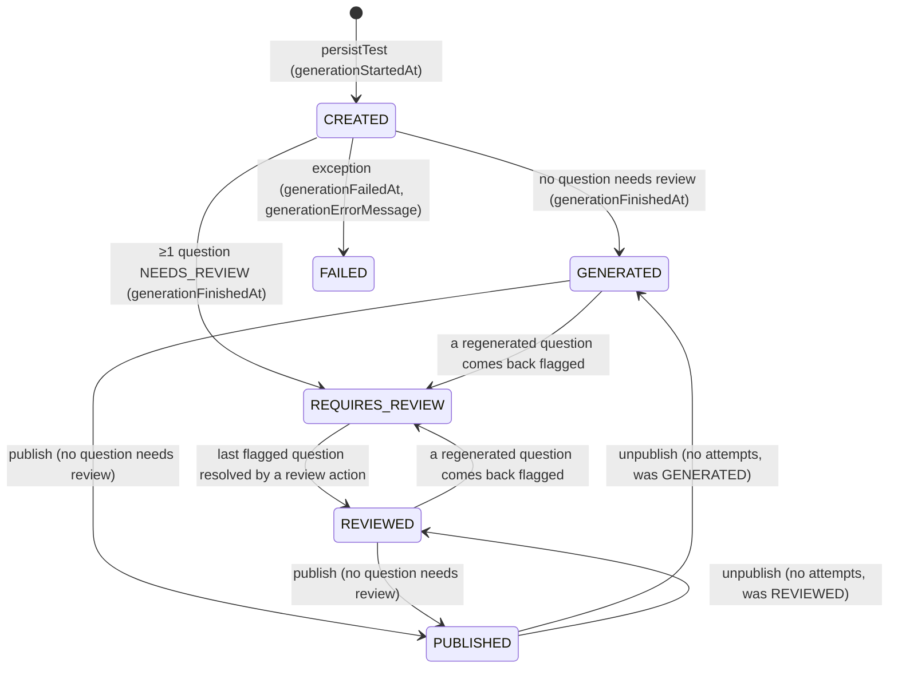
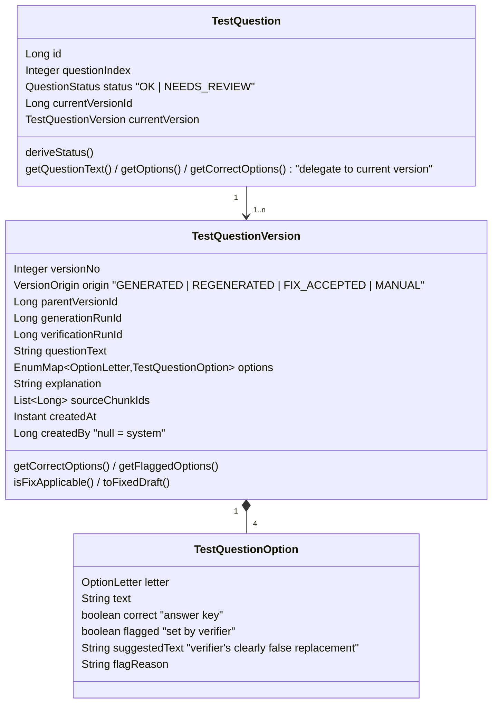

# 03 – Domain Model

The domain model lives in `knowgauge-service-core/src/main/java/com/knowgauge/core/model`. Domain objects are
plain Lombok POJOs (`@SuperBuilder`, `@Getter/@Setter`) with no persistence annotations. They are mapped to JPA
entities in the infra modules. [`DOMAIN_MODEL.md`](../../DOMAIN_MODEL.md) describes each field; this page covers
structure, relationships, lifecycles and the rules that live in the domain objects.

## Base types

`TestQuestionVersion` and `TestEvent` are insert-only. They carry their own `createdAt` / `createdBy` (or
`actorUserId`), where `null` means system, instead of the mutable audit fields. `TestQuestionOption` is a value
object.

## Aggregates and relationships

| Aggregate | Root | Notes |
|---|---|---|
| Content | `Topic` | Materialized path (`/1000/2000/2100`) enables subtree queries via `LIKE 'prefix%'`. Unique name per parent |
| Document | `Document` | Versioned (`version`, currently always 1). Unique per topic by file name **and** by SHA-256 content checksum |
| Chunks | `DocumentChunk` | Keyed by `(tenant, document, version, ordinal)`. Carries page range, char offsets and a SHA-256 checksum |
| Embedding | `ChunkEmbedding` | Lives in the **vector DB**. Denormalizes tenant/topic/document/version/section so it can be filtered without joins. Unique per `(tenant, chunk, embedding_model)` |
| Test | `Test` | Holds the generation config, scope (topic and document IDs), used chunks, status and lifecycle timestamps |
| Question | `TestQuestion` | A stable **slot** (position, status, pointer to its current version). Content lives in immutable `TestQuestionVersion`s (see [below](#questions-versions-and-review-adr001)) |
| History | `TestEvent` | Append-only trail of a test: generation, flags, review actions, status changes, with actor and time |
| Audit | `GenerationRun` | One row per LLM call (generation, regeneration, verification) with model, prompt template, chunks, tokens and raw response |
| Attempt | `Attempt` / `AttemptAnswer` | Model, tables and repository ports exist. No service or endpoint uses them yet. Answers reference the exact question version |
| Identity | `User`, `Tenant` | Model only (`Tenant` is package-private). No tables |

## Enums

| Enum | Values | Used by |
|---|---|---|
| `DocumentStatus` | `UPLOADED`, `INGESTING`, `INGESTED`, `FAILED` | Document lifecycle |
| `TestStatus` | `CREATED`, `GENERATED`, `REQUIRES_REVIEW`, `REVIEWED`, `FAILED`, `PUBLISHED` | Test lifecycle |
| `TestDifficulty` | `EASY`, `MEDIUM`, `HARD` | Prompt variable |
| `TestCoverageMode` | `BALANCED_PER_DOCS`, `BALANCED_PER_DOC_CHUNKS`, `FOCUSED` | Retrieval strategy (`FOCUSED` is not implemented) |
| `AnswerCardinality` | `SINGLE_CORRECT`, `MULTIPLE_CORRECT` | Prompt template selection, validation |
| `Language` | `EN`, `DE`, `FR`, `ES`, `IT`, `SR` | Prompt variable |
| `OptionLetter` | `A`, `B`, `C`, `D` | Option keys (exactly 4 options) |
| `QuestionStatus` | `OK`, `NEEDS_REVIEW` | Question slot status, derived from flags on the current version |
| `VersionOrigin` | `GENERATED`, `REGENERATED`, `FIX_ACCEPTED`, `MANUAL` | How a question version was created |
| `TestEventType` | `TEST_CREATED`, `TEST_GENERATED`, `TEST_REQUIRES_REVIEW`, `TEST_REVIEWED`, `TEST_FAILED`, `TEST_PUBLISHED`, `TEST_UNPUBLISHED`, `QUESTION_GENERATED`, `OPTION_FLAGGED`, `FIX_ACCEPTED`, `QUESTION_REGENERATED`, `REGENERATION_FAILED`, `QUESTION_MANUALLY_REPLACED` | History trail |
| `GenerationRunPurpose` | `TEST_GENERATION`, `REGENERATION`, `VERIFICATION` | Why an LLM call was made |
| `AttemptStatus` | `STARTED`, `SUBMITTED`, `SCORED` | Attempts (not wired) |
| `GenerationRunStatus` | `SUCCESS`, `FAILED` | Outcome of an LLM call |
| `Role` | `APPLICATION_ADMIN`, `TENANT_ADMIN`, `TENANT_USER` | Planned auth |
| `TenantType` | `INDIVIDUAL`, `ORGANIZATION` | Planned tenancy |

## Lifecycles

### Document

The state guards are enforced in the JPQL `UPDATE … WHERE status IN (…)` statements in `DocumentJpaRepository`,
and by a pre-check in `IngestionServiceImpl`. Only `INGESTED` documents can be used as a test source
(`TestDraftValidator`).

### Test

Every transition is also recorded as a `TestEvent` (`TEST_CREATED`, `TEST_GENERATED`, …, `TEST_PUBLISHED`,
`TEST_UNPUBLISHED`). The same flow as PlantUML: [diagrams/test-status-flow.puml](diagrams/test-status-flow.puml).

`PUBLISHED` is frozen ([ADR005](../adr/ADR005-publish-tests.md)): no review action can change the test, and only
published tests accept attempts. It can be unpublished back to its previous status only while no attempt exists. `TestStatus.isReviewable()`, `isPublishable()` and `acceptsAttempts()` encode the
rules.

## Questions, versions and review (ADR001)

Decided in [ADR001 – Test Review Process and Question History](../adr/ADR001-review-process.md).

Rules encoded in the domain objects:

- **A version is immutable once persisted.** Any change to a question is a new version; the slot's
  `currentVersionId` moves to it. Old versions are kept forever (`insertVersion` refuses ids, the entity is
  `@Immutable`).
- **`correct` is the answer key and only changes through a new version.** The verifier never changes it. It only
  sets `flagged`, `suggestedText` and `flagReason` on a distractor it judges to be true.
- `getCorrectOptions()` = options with `correct = true`. `getFlaggedOptions()` = options with `flagged = true`.
- `TestQuestion.deriveStatus()` = `NEEDS_REVIEW` if the current version has any flag, else `OK`. It is stored on
  the slot so it can be queried.
- `getOptions()` returns an **unmodifiable** view. `setOptions` checks that every map key equals `option.letter`.
- `isFixApplicable()` = there is at least one flag, and every flagged option has a non-blank suggestion.
- `toFixedDraft()` = a copy in which flagged options take their suggested text and lose the flag. The answer key
  stays the same.

Because flags don't affect correctness, a flagged `SINGLE_CORRECT` question passes validation and is **kept for
review**. It is no longer dropped.

### Review actions

| Action | Allowed when | New version | Event |
|---|---|---|---|
| Accept fix | Current version `isFixApplicable()` | `FIX_ACCEPTED`: flagged texts replaced by suggestions, no flags | `FIX_ACCEPTED` (payload: replaced texts) |
| Regenerate | Always (test reviewable) | `REGENERATED`: one new LLM question from the test's used chunks, verified again (may be flagged) | `QUESTION_REGENERATED`, plus `OPTION_FLAGGED` per new flag. On failure, `REGENERATION_FAILED` and no new version |
| Manual replace | Always (test reviewable) | `MANUAL`: reviewer's question and answer key, rule-validated, not LLM-verified, no flags | `QUESTION_MANUALLY_REPLACED` |

Common to all actions:

- The test must be `GENERATED`, `REQUIRES_REVIEW` or `REVIEWED`, otherwise 409 (in particular once it is
  `PUBLISHED`). The status is checked before any LLM call and again in the write transaction, after locking the
  test row (`findByTenantIdAndIdForUpdate`), so a concurrent publish cannot interleave.
- The request carries `expectedCurrentVersionId`. The slot switch is a conditional update
  (`… WHERE current_version_id = :expected`), so a concurrent change returns 409 and the whole transaction,
  including the inserted version, is rolled back.
- The new version records `createdBy` (the acting user), `parentVersionId` and `versionNo = max + 1`.
- The test status is recomputed in the same transaction (see the state diagram above).

### History trail

| Question | Where the answer is |
|---|---|
| What was generated initially? | Version 1 (`origin = GENERATED`) and its `generation_runs` row (`raw_response`) |
| What was regenerated? | Versions with `origin = REGENERATED`, `QUESTION_REGENERATED` events, `REGENERATION` runs |
| What changed during review, and by whom? | `FIX_ACCEPTED` / `QUESTION_REGENERATED` / `QUESTION_MANUALLY_REPLACED` events (`actorUserId`, from → to version), and the versions' `createdBy` |
| Why was an option flagged? | `OPTION_FLAGGED` events (option, text, suggestion, reason, verification run), and the version's `verificationRunId` |

Persistence: `test_questions` (slot) → `test_question_versions` (insert-only) → `test_question_version_options`,
plus `test_events` and `generation_runs`. See [07](07-persistence-and-storage.md#relational-schema-main-db).
