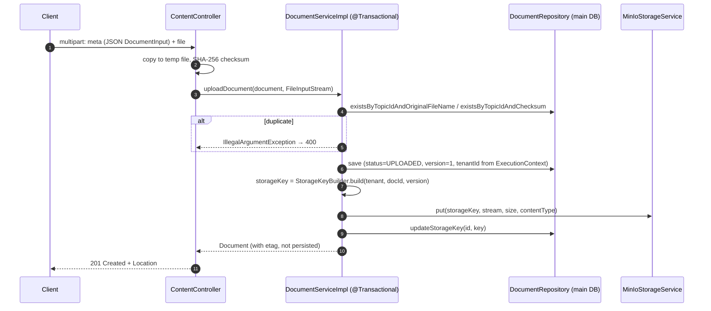
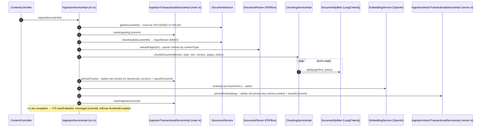

# 04 – Document Ingestion

Ingestion has two separately triggered steps:

1. **Upload**: `POST /api/content/documents` stores the binary and creates a `Document` in `UPLOADED` state.
2. **Ingest**: `POST /api/content/documents/ingestion/{id}` parses, chunks and embeds the document and moves it to
   `INGESTED`.

Both steps run synchronously on the request thread.

## 1. Upload



**Storage key template** (`kg.storage.storage-key-template`):

```
{tenantId}/docs/by-id/{shard3}/{documentId}/v{version}/source/content
```

`shard3 = documentId % 1000`, zero-padded to 3 digits. It spreads objects across key prefixes.

**Deduplication**: per topic, by original file name and by content SHA-256. Both are enforced in the service and by
DB unique constraints (`uq_documents_topic_filename`, `uq_documents_topic_contenthash`).

> The MinIO `put` runs **inside** the DB transaction. If the commit fails after the upload succeeded, the object
> is orphaned. On `delete`, the DB row is deleted first and the MinIO object second, in the same transaction, so a
> storage failure rolls back the row deletion. See [11](11-known-issues-and-roadmap.md).

## 2. Ingest



### Parsing

`PdfPageExtractionService` (`contentType() = "application/pdf"`) loads the PDF with PDFBox 3 and runs
`PDFTextStripper` once per page. It returns one string per page, normalized: CRLF→LF, runs of spaces/tabs
collapsed, trimmed. Other content types fail with `Content type … not supported`.

### Chunking

`ChunkingPolicy` is an immutable bean built from `kg.chunking.*`:

| Property | Default | Meaning |
|---|---|---|
| `maxChunkSizeChars` | 700 | Max segment size passed to the recursive splitter |
| `overlapSizeChars` | 120 | Overlap inside a page (splitter) **and** across pages (see below) |
| `trimWhitespace` | true | Trim page text and chunk text |
| `includePageMetadata` | true | Fill `startPage` / `endPage` |

`ChunkingServiceImpl` algorithm:

1. Iterate pages (1-based `pageNumber`), split each page with
   `DocumentSplitters.recursive(maxChunkSizeChars, overlapSizeChars)`.
2. For each segment, find its `charStart` within the page with `indexOf` from a moving cursor. If the segment is
   not found, it falls back to the cursor position.
3. **Cross-page overlap**: the **last** chunk of a page gets the first `overlapSizeChars` characters of the next
   page appended. Its `endPage` becomes `page+1` and `charEnd` becomes the offset within the next page.
4. `ordinal` is a global, 1-based counter across the whole document. `checksum = SHA-256(chunkText)`.

Chunks are not linked to `DocumentSection`s yet (`sectionId = null`). Section detection is on the roadmap.

### Embedding

`OpenAiEmbeddingServiceImpl` uses LangChain4j's `OpenAiEmbeddingModel` (`text-embedding-3-small` by default):

- `embed(List<String>)` makes one `embedAll` call for **all** chunks of the document. Very large documents can hit
  provider request limits; nothing sub-batches the call yet.
- It checks that every vector has `kg.embedding.dimension` (1536) dimensions. This must match `vector(1536)` in
  the pgvector schema and `@Array(length = 1536)` on the entity.
- Provider errors are translated to typed exceptions (`EmbeddingBadRequest/Auth/RateLimited/Unavailable/Unexpected`).
  Resilience4j retry, circuit breaker and bulkhead are configured per instance (`openaiEmbedding`,
  `openaiEmbeddingBatch`). See [10](10-cross-cutting-concerns.md#resilience).

### Persisting embeddings

`ChunkEmbedding` rows copy the chunk's tenant, topic, document, version, section, chunk id and checksum, plus the
`embeddingModel` name. The model name matters because **vectors are only comparable within the same model**.
Retrieval always filters on `embedding_model = embeddingService.modelName()`.

## Consistency and idempotency

- **Re-ingestion is idempotent per (document, version)**: old chunks and old embeddings (for the current model)
  are deleted before the new ones are inserted. `FAILED` documents can be re-ingested.
- **No distributed transaction**: the chunk commit (#2) and the embedding commit (#3) go to different databases.
  If embedding fails, the document is marked `FAILED`. The chunks stay in the main DB without embeddings until the
  next successful re-ingestion. Because retrieval reads only from the vector DB, orphan chunks are never sampled.
- Deleting old chunks cascades (FK `ON DELETE CASCADE`) to `test_used_chunks` rows. Re-ingesting a document
  therefore erases the used-chunk history of earlier tests that used it.
- Embeddings are not deleted when a document is deleted, because the vector DB has no FK to the main DB.
  See [11](11-known-issues-and-roadmap.md).
