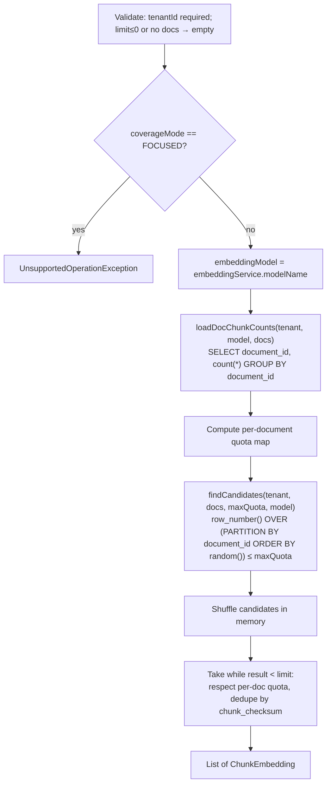

# 05 – Chunk Retrieval

Retrieval selects the chunks that become the LLM's grounding context for test generation. It lives in
`RetrievingServiceImpl` (core) and the `VectorStore` port, implemented by `PgVectorStore`.

> **It is not semantic similarity search yet.** The implemented modes do *balanced random sampling* over the
> embeddings table, which ensures coverage across the selected documents. The pgvector IVFFlat cosine index exists
> but no query uses it so far. `FOCUSED` (query-driven similarity) throws `UnsupportedOperationException`. The test
> is then marked `FAILED` and the API returns 500, because `generate()` wraps the exception (see
> [06](06-test-generation.md#step-6--persistence-and-final-status)).

## Inputs

```java
List<ChunkEmbedding> retrieveTop(Long tenantId, Collection<Long> documentIds, int limit,
                                 TestCoverageMode coverageMode, boolean avoidRepeats)
```

- `documentIds` is the expanded scope from `TestDraftValidator`: explicit documents plus the documents of the
  selected topics.
- `limit = max(kg.testgen.defaults.min-chunks-per-test, questionCount × kg.testgen.defaults.chunks-per-question)`.
  With the defaults (20, 4), a 10-question test asks for 40 chunks. This is a maximum: smaller documents return
  fewer. `TestGenerationServiceImpl` then requires at least `questionCount × kg.testgen.defaults.min-chunks-per-question`
  (default 1) chunks and fails with `InsufficientContextException` (422) otherwise.
- `avoidRepeats` is passed through but **has no effect** yet (TODO in code and backlog).

## Algorithm



### Quota strategies

| Mode | Quota per document | When it fits |
|---|---|---|
| `BALANCED_PER_DOCS` | `ceil(limit / docCount)`, clamped to `[1, limit]` | Every document should contribute equally, whatever its size |
| `BALANCED_PER_DOC_CHUNKS` (default) | `round(limit × docChunks / totalChunks)`, then a rounding-drift correction: missing slots go to the largest documents first, extra slots are removed from the largest budgets first | Representation proportional to content volume. Small documents can end up with a quota of 0 |
| `FOCUSED` | — | Not implemented |

### Candidate SQL (vector DB)

```sql
WITH ranked AS (
  SELECT ce.*, row_number() OVER (PARTITION BY ce.document_id ORDER BY random()) AS rn
  FROM chunk_embeddings ce
  WHERE ce.tenant_id = :tenantId
    AND ce.embedding_model = :embeddingModel
    AND ce.document_id IN (:documentIds)
)
SELECT <explicit column list> FROM ranked WHERE ranked.rn <= :maxChunks
```

The query fetches at most `maxQuota` rows per document. The per-document quotas are then applied in memory, which
keeps the DB load bounded on large corpora. It still does a full scan of the matching rows (to order them by
`random()`).

### Selection properties

- **Non-deterministic**: two generations over the same scope get different chunks.
- **Checksum dedupe**: identical chunk text (for example a repeated header or footer, or the same content in two
  documents) is selected at most once.
- The retrieved chunk IDs are stored as the test's `usedChunks` (`test_used_chunks`) right after retrieval,
  **before** generation runs. The embeddings are then reloaded as `DocumentChunk`s from the **main DB** with
  `DocumentChunkRepository.findByTenantIdAndIdIn`, because the chunk text lives only there.

## Extension points

- **FOCUSED mode**: embed a query (topic description or user prompt) with `EmbeddingService.embed(String)`, then
  `ORDER BY embedding <=> :query LIMIT n` using the existing IVFFlat `vector_cosine_ops` index.
- **Avoid repeats**: exclude chunk IDs found in `test_used_chunks` of earlier `GENERATED` tests. `test_used_chunks`
  is in the main DB, so the excluded IDs have to be passed to the vector DB query as a parameter. A cross-DB join
  is not possible.
- **Re-ranking**: an optional second stage after candidate retrieval.
