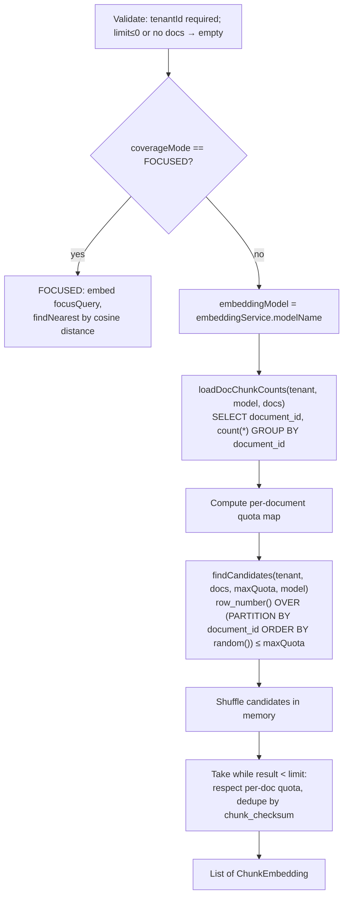

# 05 – Chunk Retrieval

Retrieval selects the chunks that become the LLM's grounding context for test generation. It lives in
`RetrievingServiceImpl` (core) and the `VectorStore` port, implemented by `PgVectorStore`.

There are two kinds of retrieval:

- The **balanced** modes (`BALANCED_PER_DOC_CHUNKS`, the default, and `BALANCED_PER_DOCS`) do *balanced random
  sampling* over the embeddings table, which spreads the questions over all the selected documents.
- **`FOCUSED`** is a *semantic similarity search*: it embeds the test's `focusQuery` and takes the chunks closest to
  it (see [FOCUSED](#focused-similarity-search) below).

## Inputs

```java
List<ChunkEmbedding> retrieveTop(Long tenantId, Collection<Long> documentIds, int limit,
                                 TestCoverageMode coverageMode, String focusQuery, boolean avoidRepeats)
```

- `focusQuery` is required for `FOCUSED` (`TestDraftValidator` rejects a blank one, max 2000 characters, and clears
  it for the balanced modes). The DB enforces the same rule with `chk_tests_focus_query` (`V2__focused_coverage.sql`).

- `documentIds` is the expanded scope from `TestDraftValidator`: explicit documents (which must be ingested) plus the
  ingested documents of the selected topics **and all their sub-topics**; documents not ingested yet are skipped.
- `limit = max(kg.testgen.defaults.min-chunks-per-test, questionCount × kg.testgen.defaults.chunks-per-question)`.
  With the defaults (20, 4), a 10-question test asks for 40 chunks. This is a maximum: smaller documents return
  fewer. `TestGenerationServiceImpl` then requires at least `questionCount × kg.testgen.defaults.min-chunks-per-question`
  (default 1) chunks and fails with `InsufficientContextException` (422) otherwise.
- `avoidRepeats` is passed through but **has no effect** yet (TODO in code and backlog).

## Algorithm



### Quota strategies

| Mode | Quota per document | When it fits |
|---|---|---|
| `BALANCED_PER_DOCS` | `ceil(limit / docCount)`, clamped to `[1, limit]` | Every document should contribute equally, whatever its size |
| `BALANCED_PER_DOC_CHUNKS` (default) | `round(limit × docChunks / totalChunks)`, then a rounding-drift correction: missing slots go to the largest documents first, extra slots are removed from the largest budgets first | Representation proportional to content volume. Small documents can end up with a quota of 0 |
| `FOCUSED` | None: similarity decides (see below) | Questions about one subject inside broad material |

### Candidate SQL (vector DB)

```sql
WITH ranked AS (
  SELECT ce.*, row_number() OVER (PARTITION BY ce.document_id ORDER BY random()) AS rn
  FROM chunk_embeddings ce
  WHERE ce.tenant_id = :tenantId
    AND ce.embedding_model = :embeddingModel
    AND ce.document_id IN (:documentIds)
)
SELECT <explicit column list> FROM ranked WHERE ranked.rn <= :maxChunks
```

The query fetches at most `maxQuota` rows per document. The per-document quotas are then applied in memory, which
keeps the DB load bounded on large corpora. It still does a full scan of the matching rows (to order them by
`random()`).

### Selection properties

- **Non-deterministic** (balanced modes): two generations over the same scope get different chunks.
- **Checksum dedupe**: identical chunk text (for example a repeated header or footer, or the same content in two
  documents) is selected at most once.
- The retrieved chunk IDs are stored as the test's `usedChunks` (`test_used_chunks`) right after retrieval,
  **before** generation runs. The embeddings are then reloaded as `DocumentChunk`s from the **main DB** with
  `DocumentChunkRepository.findByTenantIdAndIdIn`, because the chunk text lives only there.

## FOCUSED: similarity search

1. `EmbeddingService.embed(focusQuery)` embeds the focus text with the same model as the chunks
   (`embeddingService.modelName()`), so the vectors are comparable.
2. `VectorStore.findNearest` returns the chunks of the documents in scope ordered by cosine distance, nearest
   first, filtered by `tenant_id`, `embedding_model` and `document_id`:

   ```sql
   SELECT set_config('ivfflat.probes', '100', true);   -- this transaction only
   SELECT … FROM chunk_embeddings ce
   WHERE ce.tenant_id = :tenantId AND ce.embedding_model = :embeddingModel AND ce.document_id IN (:documentIds)
   ORDER BY ce.embedding <=> CAST(:query AS vector)
   LIMIT :limit
   ```

   The IVFFlat index has `lists = 100`. With pgvector's default of one probe it scans a single list and, combined
   with the filters, can return far fewer rows than asked for, so the query sets `probes` to 100, which makes the
   search exact. Raise both together if the index is rebuilt with more lists.
3. Only chunks **about the focus** are kept (`kg.retrieval.focused.*`, `FocusedRetrievalProperties`):
   - at most `max-gap-to-best` (0.20) further away than the closest chunk,
   - never further than `max-distance` (0.65),
   - at most the same `limit` as the balanced modes, `max(min-chunks-per-test, questions × chunks-per-question)`,
     so a larger test can use more matching chunks.

   It asks the vector store for `2 × limit + 5` nearest rows. Distances are computed in Java from the returned
   embeddings; identical content (checksum) is kept once. The log line `Focused retrieval: …` lists every kept chunk
   with its distance.
4. Generation then needs at least `ceil(questions × focused-min-chunks-per-question)` chunks
   (`kg.testgen.defaults.focused-min-chunks-per-question`, default **0.5**: up to two questions per chunk). Balanced
   tests keep `min-chunks-per-question` (1). The lower floor fits focused retrieval, which never pads with unrelated
   chunks; a 700-character chunk usually holds several separate facts.

The cut-off is what makes a focus visible in the test. Without it, a narrow focus is padded with the next-closest,
unrelated material: a 10-question test asks for up to 40 chunks, which can be the whole scope. Measured with
`text-embedding-3-small`, chunks about the focus lie within about 0.2 of the closest one, while other subjects are
0.6 or more away and an unrelated focus starts at about 0.75. So a narrow focus yields few chunks, and a focus the
scope does not cover yields none. Generation then fails with `InsufficientContextException` (422) and a message that
says how many passages match the focus and how many questions to ask for at most.

Unlike the balanced modes there are **no per-document quotas**: the focus text decides which documents contribute,
and the selection is deterministic for the same scope and focus text. The chunks keep their distance order, so the
first generation batch gets the closest ones.

The demo topic **Office Guides** (`demo-content/office-guides`) is written for trying this: three guides with the same
four subjects, where each subject focus selects 6–9 chunks from all three guides, enough for 12–18 questions.

Generation splits the chunks into one slice per batch of `question-generation-batch-size` questions, sized in
proportion to each batch's question count (for example 7 and 3 chunks for batches of 5 and 2 questions), so a
small last batch does not take chunks that a full batch needs.

## Extension points

- **Avoid repeats**: exclude chunk IDs found in `test_used_chunks` of earlier `GENERATED` tests. `test_used_chunks`
  is in the main DB, so the excluded IDs have to be passed to the vector DB query as a parameter. A cross-DB join
  is not possible.
- **Re-ranking**: an optional second stage after candidate retrieval.
