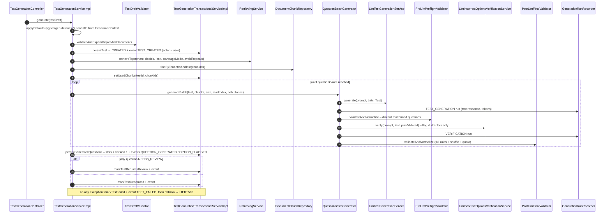
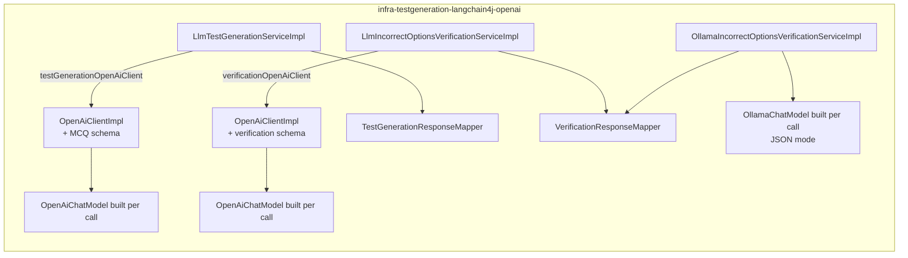

# 06 – Test Generation

Test generation is the core RAG pipeline. `TestGenerationServiceImpl.generate(Test)` orchestrates it. The
orchestrator is **not** transactional. It persists state through `TestGenerationTransactionalServiceImpl`. The
per-batch work (prompt → LLM → validate → verify → validate) lives in `QuestionBatchGenerator`, which is shared
with single-question **regeneration** during review ([ADR001](../adr/ADR001-review-process.md)).

Every LLM call is written to `generation_runs` by `GenerationRunRecorder`: model, prompt template, chunks, raw
response, tokens, finish reason and status. Every state change is written to `test_events` by
`TestHistoryRecorder`, in the same transaction as the change.

## End-to-end flow



## Step 0 – Defaults and draft validation

`applyDefaults` fills every `null` field of the request from `TestGenerationDefaultsProperties`
(`kg.testgen.defaults.*`): difficulty, avoidRepeats, coverageMode, questionCount, answerCardinality, language,
promptTemplateId and generationModel. It also computes `minMultipleCorrectQuestionsCount`:

```
MULTIPLE_CORRECT: max(1, ceil(questionCount × min-multiple-correct-percentage / 100))   (default 50%)
otherwise:        0
```

`TestDraftValidator` rules:

- At least one `topicId` or `documentId`, and `questionCount > 0`.
- Every topic and document exists and belongs to the tenant.
- The source documents are the explicit documents plus the documents **directly** attached to the selected topics,
  deduplicated with order kept.
- The resulting list is non-empty and **every** document is `INGESTED`.
- `topicIds` is then expanded with all descendants (path prefix) for the record. Documents under descendant topics
  are **not** added to the source set, only documents of the selected topics themselves.

## Step 1 – Batched generation

`kg.testgen.defaults.question-generation-batch-size` (default 5) sets the batch size. For each batch:

1. A **batch copy** of the test is made with `questionCount = batchSize` and a batch-level
   `minMultipleCorrectQuestionsCount`.
2. The prompt is built from the **same chunk set** for every batch. All retrieved chunks go into every prompt.
3. Generation, pre-validation, verification and post-validation run.
4. The number of questions generated so far advances by the number that survived validation. Question indexes
   continue from it.

**Token-limit backoff**: if the LLM stops with `finish_reason = length`, `OpenAiClientImpl` throws
`LlmResponseParsingException(LENGTH)`. A `FAILED` run is recorded and the batch is retried with `batchSize - 1`,
down to 1. Other `LlmResponseParsingException` reasons are recorded and rethrown immediately.

**Zero-progress guard**: a batch that yields 0 valid questions increments a counter, and a batch with output
resets it. Once the counter reaches `max-consecutive-zero-progress-batches` (default **1**, fallback 3 if unset),
the generation fails with `IllegalStateException`. With the default, the first empty batch fails the whole test.

> Duplicate questions across batches are not detected. Dedupe works only within a batch, and every batch sees the
> same context, so repeats are possible.

## Step 2 – Prompt construction

Templates are plain text files in `knowgauge-service-core/src/main/resources/prompttemplates/`. They are loaded by
`ClasspathPromptTemplateLoader` (`{classpathBase}{templateId}.txt`) and rendered by
`DefaultPromptTemplateRenderer` with simple `{{variable}}` replacement.

| Template file | Selected when |
|---|---|
| `mcq-default.txt` | `promptTemplateId = mcq-default` and `SINGLE_CORRECT` |
| `mcq-default-multiple-correct.txt` | `MULTIPLE_CORRECT`: the builder appends the suffix `-multiple-correct` |
| `mcq-default-multiple-correct-full.txt` | Not selected automatically. A longer variant with evidence requirements, reachable as `promptTemplateId=mcq-default-multiple-correct-full` only for `SINGLE_CORRECT` (otherwise the suffix is appended again) |
| `incorrect-options-verification-only-flagged.txt` | **Default** verification prompt (`kg.testgen.verification.defaults.prompt-template-id`). Returns only distractors judged true |
| `incorrect-options-verification.txt` | Alternative verification prompt that returns every verdict (the mapper flags only the true ones) |

Generation variables: `difficulty`, `questionCount`, `language`, `minMulti`, `model`, `context`, `outputSchema`.
For regeneration, the builder appends the existing question texts of the test with an instruction not to repeat
them.
The `context` block joins the chunks with `\n\n---\n\n`. Each chunk gets a header
`[SOURCE: topicId=… docId=… chunkId=…]` so the model can cite chunk IDs.

**Output schemas** are example JSON documents, not JSON Schema:

- `mcq-output-template.json` → `{questions:[{question, options{A..D}, correctOptions[], explanation, sources[]}]}`
- `verification-output-template.json` → `{results:[{questionIndex, questionText, evaluatedAnswers[{option, originalAnswer, verdict, replacementAnswer, explanation}]}]}`

`SchemaProvidersConfig` exposes them as two qualified `SchemaProvider` beans
(`testGenerationOutputSchemaProvider`, `verificationOutputSchemaProvider`). The schema is used twice: it is
injected into the prompt text (`{{outputSchema}}`), and `OpenAiClientImpl` converts it into a LangChain4j
`JsonSchema` for **structured output**. The conversion infers types from the example values, sets
`additionalProperties=false` and makes all fields required.

## Step 3 – LLM call (infra)



- **Verifier provider**: `kg.testgen.verification.provider` picks one adapter for the
  `LlmIncorrectOptionsVerificationService` port. `openai` (the default in `application.properties`) uses
  `LlmIncorrectOptionsVerificationServiceImpl`. `ollama` (set in the `dev` and `docker` profiles) uses
  `OllamaIncorrectOptionsVerificationServiceImpl`. It runs the same prompt on a local model
  (`kg.testgen.verification.chat-model.ollama.*`, default `qwen2.5:7b-instruct`) in Ollama's JSON mode and maps the
  reply with the same `VerificationResponseMapper`, so it spends no OpenAI tokens. See
  [ADR002](../adr/ADR002-local-verification-model.md).

- An `OpenAiChatModel` is **built per call**. Model, temperature, max tokens and timeout are resolved with this
  precedence: generation: `Test.generationModel` / `generationParams.temperature|maxOutputTokens` →
  `kg.testgen.chat-model.openai.*`. Verification: `generationParams.verificationModel|verificationTemperature|verificationMaxOutputTokens`
  → `kg.testgen.verification.chat-model.openai.*` → main chat-model properties. The Ollama verifier uses the same
  `generationParams` overrides, then `kg.testgen.verification.chat-model.ollama.*`.
- **Structured output** is turned on when the model name starts with one of
  `kg.testgen.chat-model.openai.structured-output-model-prefixes` (`gpt-4.1,gpt-4o,o1,o3,o4`). Then
  `strictJsonSchema(true)` is set and the `responseFormat` is attached. In every case the prompt gets the suffix
  "Return ONLY a valid JSON …".
- Token usage and finish reason are logged per call and returned as `LlmCallMetadata` (model, raw response,
  tokens, finish reason) in `LlmGenerationResult` / `LlmVerificationResult`, so the core can record the run.
- **Response mapping**: take the text from the first `{` to the last `}`, then deserialize with Jackson. Failures
  become `LlmResponseParsingException(PARSING_ERROR | MAPPING_ERROR)`. Generation DTOs become draft
  `TestQuestion`s whose options carry `text` and `correct` (the answer key). `sources` such as `"chunk12"` become
  `12L` by keeping only the digits.
- An `INSUFFICIENT_CONTEXT` reply (possible only when structured output is off) contains no `{`, so the JSON
  parse fails with `PARSING_ERROR` and the test fails.

## Step 4 – Validation

`TestQuestionValidator` is one stateless engine. It is configured with a list of `ValidationStrategy` values and
used through two facades, plus `validateManual` for reviewer-written questions (normalize, structure, bundled,
count-revealing, cardinality, and "no duplicate of another question in the test"; it returns every reason).
Correctness is always read from the answer key (`option.correct`); **verifier flags never affect validation**.

| Strategy | Pre-LLM (`PreLlmPreflightValidator`) | Post-LLM (`PostLlmFinalValidator`) | Rule |
|---|:-:|:-:|---|
| `NORMALIZE_FIELDS` | ✔ | ✔ | NFKC, collapse whitespace, strip `Q1:` / `Question:` prefixes |
| `STRUCTURE` | ✔ | ✔ | Question 12–240 chars. Options A–D all present (`requireAllFourOptions=true`), each ≤140 chars. ≥1 correct option and correct options non-blank. Explanation ≤500 chars. No duplicate options. No "all/none of the above/these" |
| `GROUNDING` | ✔ | ✔ | Drops cited chunk IDs that were not retrieved. Rejects only if `requireGrounding` (default **false**) |
| `BUNDLED_OPTIONS` | ✔ | ✔ | Rejects "mega options": ≥3 `,`/`;` **and** ≥14 words **and** contains " and " / " or " / " as well as " |
| `COUNT_REVEALING` | ✔ | ✔ | Multi-correct question text must not match `(which|select|choose) (two|three|four|\d+)` |
| `DEDUPE` | ✔ | ✔ | Key = normalized question + sorted normalized options (order-independent), within the batch |
| `CORRECT_OPTIONS_CARDINALITY` | ✔ | ✔ | `SINGLE_CORRECT` → exactly 1 correct option. Otherwise ≥1 |
| `DUPLICATE_SUGGESTIONS` |  | ✔ | Never rejects. Clears a verifier suggestion that matches any option's text (its own included) or another suggestion; the flag stays, so Accept fix is unavailable and the reviewer regenerates or edits |
| `SHUFFLE_AND_REMAP` |  | ✔ | Shuffles the option **objects** randomly and reassigns their letters, so the answer key and flags move with the text |
| `POST_SHUFFLE_SANITY` |  | ✔ | Re-checks the structure, duplicates, bundling and count-revealing rules |
| `MULTI_CORRECT_QUOTA` |  | ✔ | For `MULTIPLE_CORRECT`, the batch must contain at least `minMultipleCorrectQuestionsCount` questions with ≥2 correct options, **otherwise the whole batch is discarded** (counts as zero progress) |

Rejections are logged at WARN with the reason and a 140-char preview of the question. Valid questions get
sequential `questionIndex` values starting at the batch's start index, and the list is capped at the batch's
`questionCount`.

## Step 5 – Incorrect-option verification

The verifier answers one question: *"Is any option the generator marked as wrong actually correct?"*

1. `VerificationPromptBuilder` serializes each pre-validated question to
   `{questionIndex: <position in batch>, questionText, answers{letter→text}}`. Only distractors
   (`correct = false`) are included.
2. The verification model (temperature 0 by default) returns the distractors it judges true, each with a clearly
   false replacement and an explanation.
3. `VerificationResponseMapper` **flags** each such option in place (`flagged = true`, `suggestedText`,
   `flagReason`). It never changes `correct`.
4. The call is recorded as a `VERIFICATION` run, and each draft records it as `verificationRunId`.

Verification runs for every batch, whatever the cardinality. It is **best effort**: a failure is recorded as a
`FAILED` run, and generation continues with unverified questions. This includes an Ollama server that is down or a
model that has not been pulled.

A flagged question passes validation unchanged (flags don't affect correctness), so it is **kept** with status
`NEEDS_REVIEW` and later resolved through a review action. See
[03 – Questions, versions and review](03-domain-model.md#questions-versions-and-review-adr001).

## Step 6 – Persistence and final status

- All validated questions are saved at the end in **one** transaction: each becomes a slot plus version 1
  (`origin = GENERATED`, `createdBy = null`), and `QUESTION_GENERATED` / `OPTION_FLAGGED` events are written. If
  the process dies mid-way, no questions are saved and the test stays in `CREATED` (the generation runs already
  recorded remain). No sweeper resets such tests.
- A question whose generator gave no source chunks gets **all** used chunk IDs as its sources.
- Final status: `REQUIRES_REVIEW` if any question is `NEEDS_REVIEW`, otherwise `GENERATED`, each with an event.
  On failure the status is `FAILED` with `generationFailedAt`, `generationErrorMessage` and a `TEST_FAILED` event.
- HTTP status: errors raised **before** `persistTest` (draft validation, `IllegalArgumentException`) return
  **400**. Every error **after** it, including `FOCUSED` mode and `LlmResponseParsingException`, is wrapped by
  `generate()` in a plain `RuntimeException` and returns **500**. The typed handlers (507/502, 400 for unsupported
  operations) therefore never fire for generation.

## Tunables (defaults)

| Property | Default | Effect |
|---|---|---|
| `kg.testgen.defaults.question-count` | 10 | Questions per test |
| `kg.testgen.defaults.question-generation-batch-size` | 5 | Questions per LLM call |
| `kg.testgen.defaults.chunks-per-question` | 4 | Retrieval limit factor |
| `kg.testgen.defaults.min-chunks-per-test` | 20 | Retrieval floor |
| `kg.testgen.defaults.min-multiple-correct-percentage` | 50 | Multi-correct quota |
| `kg.testgen.defaults.max-consecutive-zero-progress-batches` | 1 | Failure threshold |
| `kg.testgen.defaults.generation-model` | `gpt-4.1` | Generation model |
| `kg.testgen.chat-model.openai.temperature` / `max-output-tokens` / `timeout-seconds` | 0.2 / 1200 / 60 | Generation call |
| `kg.testgen.verification.provider` | `openai` (`ollama` in dev/docker) | Verifier adapter |
| `kg.testgen.verification.chat-model.openai.model` / `temperature` / `max-output-tokens` / `timeout-seconds` | `gpt-4.1` / 0 / 800 / 30 | Verification call (OpenAI) |
| `kg.testgen.verification.chat-model.ollama.base-url` / `model` / `temperature` / `max-output-tokens` / `timeout-seconds` | `http://localhost:11434` / `qwen2.5:7b-instruct` / 0 / 800 / 120 | Verification call (Ollama) |
