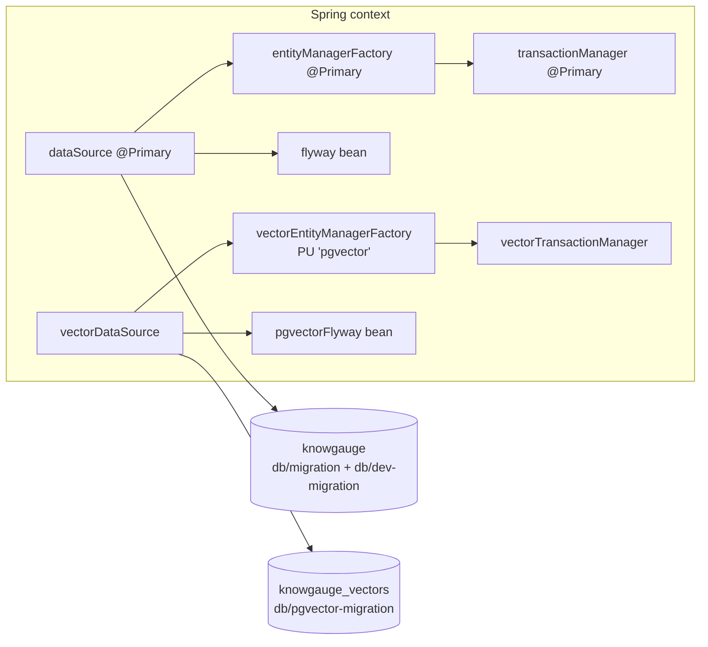

# 07 – Persistence & Storage

KnowGauge uses **three stores**: a relational PostgreSQL database (system of record), a separate PostgreSQL
database with the pgvector extension for embeddings, and MinIO for the original files.



## Why two databases?

The embeddings sit in their own database (`chunk_embeddings` copies the tenant, topic, document, version and
section metadata) so the vector store can later move to a dedicated vector DB without touching the relational
model. The cost is **no foreign keys and no transactions across the two stores**. See
[04](04-document-ingestion.md#consistency-and-idempotency).

## Wiring

| Bean | Module | Notes |
|---|---|---|
| `mainDataSourceProperties` / `dataSource` / `entityManagerFactory` / `transactionManager` | `infra-repository-springdata-jpa` → `MainJpaConfig` | All `@Primary`. Binds `spring.datasource.*`. Scans `…infra.repository.jpa.entity`, repos in `…jpa.repository` |
| `flyway` | `MainJpaConfig` sibling `MainFlywayConfig` | `initMethod="migrate"`, binds `spring.flyway.*` (locations, schemas, baseline-on-migrate) |
| `vectorDataSourceProperties` / `vectorDataSource` / `vectorEntityManagerFactory` / `vectorTransactionManager` | `infra-vectorstore-pgvector` → `PgVectorJpaConfig` | Binds `kg.pgvector.datasource.*`. Persistence unit name `pgvector` |
| `pgvectorFlyway` | `PgVectorFlywayConfig` | Binds `kg.pgvector.flyway.*`. Can be turned off with `kg.pgvector.flyway.enabled=false` |

`KnowGaugeApplication` `@Import`s both JPA configs explicitly. Hibernate runs with `ddl-auto=validate`, so
**Flyway owns the schema** and the entities must match it exactly.

Code that writes to the vector DB must use `@Transactional(transactionManager = "vectorTransactionManager")`
(see `IngestionVectorTransactionalServiceImpl`). Native queries in `PgVectorStore` use
`@PersistenceContext(unitName = "pgvector")`. Spring Data derived **delete** methods misbehave on the secondary
persistence unit, so `ChunkEmbeddingJpaRepository` uses explicit `@Modifying` JPQL deletes. The repository has a
comment explaining this.

## Migrations

All Flyway scripts live in `knowgauge-service-rest-api/src/main/resources/db/`:

| Location | DB | Content | Active in |
|---|---|---|---|
| `db/migration/V1__create_initial_schema.sql` | main | Full relational schema | all profiles |
| `db/dev-migration/R__dev_seed_topics.sql` | main | Repeatable seed of a fixed-ID topic tree (tenant 1) | `local` only (added to `spring.flyway.locations`) |
| `db/pgvector-migration/V1__pgvector_and_embeddings.sql` | vector | `CREATE EXTENSION vector`, `chunk_embeddings`, indexes | all profiles |

> The schema is still a single `V1` that is edited in place. This works only while databases are recreated (an
> existing database fails Flyway's checksum validation after every change). Once a shared or persistent environment
> exists, add new `V{n}__*.sql` files instead of editing `V1`.

## Relational schema (main DB)

| Table | Key columns / constraints | Notes |
|---|---|---|
| `topics` | `parent_id` FK self (cascade), `UNIQUE(parent_id,name)`, `UNIQUE(path)`, `text_pattern_ops` index on `path` | Materialized-path tree. Uniqueness is **not** tenant-scoped |
| `documents` | FK topic (cascade). `UNIQUE(topic_id, original_file_name)`, `UNIQUE(topic_id, checksum)`, status CHECK | `storage_key`, `version`, `error_message`, `ingested_at` |
| `document_sections` | FK document (cascade) | Not populated yet |
| `document_chunks` | FKs document/topic (cascade), section (set null). `UNIQUE(tenant, document, version, ordinal)` | Indexes for (tenant, doc, ver), (tenant, topic), (tenant, checksum) |
| `tests` | `name VARCHAR(200) NOT NULL` (non-blank CHECK). CHECKs on status, difficulty, coverage, cardinality, language, `question_count>0`, lifecycle ordering | `description TEXT` (nullable), `generation_params_json JSONB` |
| `test_questions` | FK test (cascade), `UNIQUE(test_id, question_index)`, status CHECK (`OK`/`NEEDS_REVIEW`), `current_version_id` FK → versions (set null) | Question **slot** ([ADR001](../adr/ADR001-review-process.md)) |
| `test_question_versions` | FK question (cascade), parent version (set null), generation and verification run (set null). `UNIQUE(question_id, version_no)`, origin CHECK | **Insert-only** content snapshots. `created_by` NULL = system |
| `test_question_version_options` | FK version (cascade), `UNIQUE(version_id, option_letter)`, letter CHECK | `text`, `correct`, `flagged`, `suggested_text`, `flag_reason`. Insert-only |
| `test_events` | FK test and question (cascade), event-type CHECK | **Append-only** history: actor, from/to version, comment, `payload_json JSONB` |
| `generation_runs` | FK test and question (cascade), purpose/status CHECKs | One row per LLM call: model, prompt template, chunks, prompt as sent, request params, raw response, tokens, finish reason |
| `test_used_chunks` / `test_covered_topics` / `test_covered_documents` | Composite PKs, cascade FKs | `@ManyToMany` join tables on `TestEntity` |
| `attempts`, `attempt_answers`, `attempt_answer_chosen_options` | Cascades, CHECKs. `attempt_answers.question_version_id` FK → versions | Not used by any service yet |

Slots and versions reference each other (`current_version_id` ↔ `question_id`). New questions are therefore
saved in three steps inside one transaction: slot, then version 1, then the slot's pointer.

Most tables have the audit columns `created_at/updated_at/created_by/updated_by`. The insert-only tables
(`test_question_versions`, `test_question_version_options`, `test_events`) have only creation data. On the entity side
`AuditableEntity` fills them with `@PrePersist`/`@PreUpdate` (user hard-coded to `1`). See
[10](10-cross-cutting-concerns.md#auditing).

JSONB columns are mapped with Hypersistence `@Type(JsonType.class)` (`Map<String,Object>`, `List<Long>`).

## Vector schema (vector DB)

```sql
chunk_embeddings(
  id, tenant_id, topic_id, document_id, document_version, section_id, chunk_id,
  chunk_checksum VARCHAR(64),         -- drift detection vs document_chunks.checksum
  embedding vector(1536) NOT NULL,
  embedding_model VARCHAR(100),
  audit columns,
  UNIQUE (tenant_id, chunk_id, embedding_model)
)
-- indexes: (tenant, document, version), (tenant, topic), (tenant, model), (tenant, chunk_id)
-- ivfflat (embedding vector_cosine_ops) WITH (lists = 100)
```

The entity maps `embedding` as `float[]` with `@JdbcTypeCode(SqlTypes.VECTOR)` and `@Array(length = 1536)`. To
change the embedding model dimension, update the migration, the entity annotation and `kg.embedding.dimension`
together.

## Object storage (MinIO)

- Bucket: `kg.storage.bucket` (`knowgauge-content`). It is created at startup by `DevDocumentSeeder` through
  `StorageService.ensureBucketExists()`, **only** in the `local` profile with `kg.dev.seed.enabled=true`. Other
  environments must create the bucket beforehand.
- Key layout: `{tenantId}/docs/by-id/{shard3}/{documentId}/v{version}/source/content` (see
  [04](04-document-ingestion.md#1-upload)).
- `MinioClient` uses an OkHttp client with connect/read/write/call timeouts from `kg.storage.*Timeout` (seconds).
- Operations: `put` (stream with known size), `download(key, OutputStream)` (streams to the HTTP response and does
  not close it), `download(key)` (returns an `InputStream` the **caller must close**), `delete`.
- Errors are translated: 5xx/IO → `StorageUnavailableException` (retryable), 404 → `StorageNotFoundException`,
  401/403 → `StorageAuthException`, other → `StorageBadRequestException`, anything else →
  `StorageUnexpectedException`.
