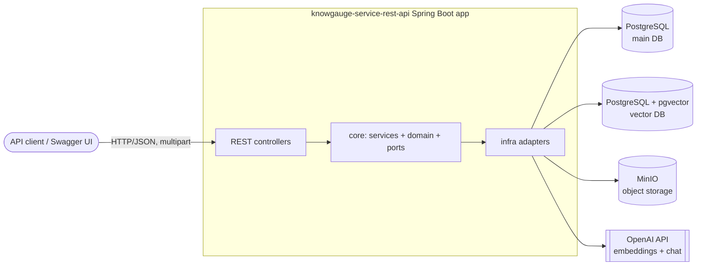

# KnowGauge – Architecture Documentation

KnowGauge is a RAG-based Spring Boot service. Users upload documents (PDFs), organize them in a hierarchical
topic tree, and the service generates multiple-choice tests (MCQs) from that content using an LLM. An
LLM verification pass checks the incorrect options of each question.

This folder describes the architecture **as implemented** in the code (not aspirational), plus known gaps.

| # | Document | What it covers |
|---|----------|----------------|
| 01 | [System Overview](01-system-overview.md) | Purpose, system context, runtime topology, tech stack |
| 02 | [Modules & Layering](02-modules-and-layering.md) | Maven modules, hexagonal architecture, ports & adapters, package conventions |
| 03 | [Domain Model](03-domain-model.md) | Entities, enums, lifecycles/state machines, option verdict model |
| 04 | [Document Ingestion](04-document-ingestion.md) | Upload → storage → parse → chunk → embed pipeline |
| 05 | [Chunk Retrieval](05-retrieval.md) | Coverage modes, per-document quotas, pgvector candidate sampling |
| 06 | [Test Generation](06-test-generation.md) | Batch generation, prompts, validation, incorrect-option verification |
| 07 | [Persistence & Storage](07-persistence-and-storage.md) | Two databases, transaction managers, Flyway, schema, MinIO |
| 08 | [REST API](08-rest-api.md) | Endpoints, DTOs, error mapping |
| 09 | [Configuration & Deployment](09-configuration-and-deployment.md) | Properties, profiles, Docker Compose, environment variables |
| 10 | [Cross-Cutting Concerns](10-cross-cutting-concerns.md) | Resilience, multi-tenancy, auditing, exceptions, logging, security |
| 11 | [Known Issues & Roadmap](11-known-issues-and-roadmap.md) | Gaps, technical debt, risks and planned work |

Related material elsewhere in the repo:

- [`DOMAIN_MODEL.md`](../../DOMAIN_MODEL.md): field-level description of each entity
- [`TODO.md`](../../TODO.md): backlog
- [`docs/adr/`](../adr/): Architecture Decision Records
  - [ADR001 – Test Review Process and Question History](../adr/ADR001-review-process.md) (ACCEPTED, implemented): replaces
    the three-tier option model with immutable question versions, an event log and three review actions (accept fix / regenerate / manual replace)
  - More candidate ADRs are listed in [11](11-known-issues-and-roadmap.md#candidate-adrs)

## Architecture at a glance

The two main flows:

1. **Ingestion**: `POST /api/content/documents` stores the file in MinIO and its metadata in the main DB.
   `POST /api/content/documents/ingestion/{id}` then runs PDFBox (parse), the LangChain4j recursive splitter
   (chunk) and OpenAI embeddings (embed). Chunks go to the main DB and vectors go to pgvector.
2. **Test generation**: `POST /api/tests` validates the request and expands its topic and document scope. It then
   samples chunks from pgvector and generates questions in batches (LLM), validates them, verifies the incorrect
   options (a second LLM call), validates again and persists the result. The test ends as `GENERATED`,
   `REQUIRES_REVIEW` or `FAILED`.

Both flows run **synchronously inside the HTTP request**.
